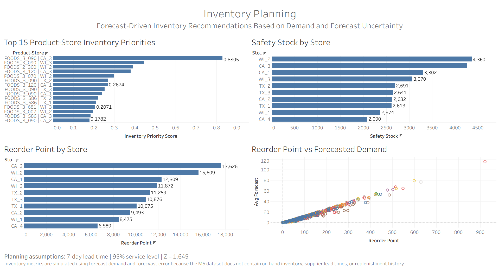
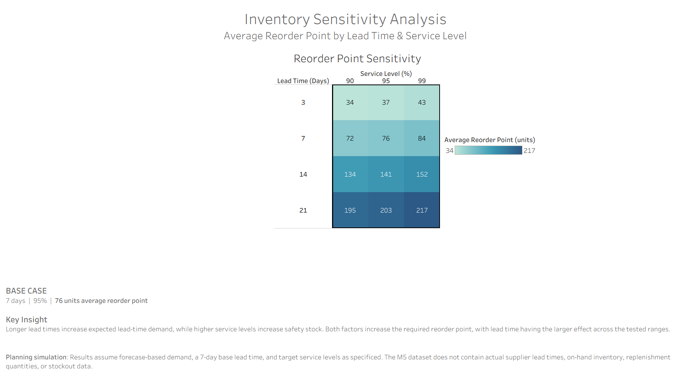

# Retail Demand Forecasting & Inventory Analytics

## Overview

This project analyzes retail demand across products and stores and develops a machine learning forecasting pipeline to support inventory planning decisions.

Using the M5 retail sales dataset, the project combines exploratory data analysis, feature engineering, time-series forecasting, model evaluation, and inventory analytics to identify demand patterns and translate forecasts into actionable business recommendations.

### Project Pipeline

**Data Cleaning → EDA → Feature Engineering → Forecasting → Model Evaluation → Inventory Analytics → Sensitivity Analysis → Tableau Dashboards**

---

## Business Problem

Retailers need accurate demand forecasts to make effective inventory decisions.

Poor forecasts can lead to:

* Stockouts and lost sales
* Excess inventory
* Inefficient allocation of inventory across stores
* Increased holding costs

The goal of this project is to determine whether historical demand, calendar patterns, product/store characteristics, events, and pricing can improve demand forecasts and support inventory planning.

---

## Dataset

The project uses the **M5 retail sales dataset**.

### Dataset Characteristics

* 3,049 products
* 10 stores
* 3 states
* 7 departments
* 3 categories
* 1,913 daily observations
* Date range: January 29, 2011 – June 19, 2016

The dataset consists of:

* `sales` — historical daily unit sales
* `calendar` — dates, weekdays, events, and SNAP indicators
* `prices` — historical product/store prices

---

# 1. Exploratory Data Analysis

EDA was performed to identify the major patterns that should inform the forecasting model.

### Key Findings

**Strong weekly seasonality**

Weekend demand was substantially higher than weekday demand, with Saturday and Sunday showing the highest average daily sales.

**Store-level demand variation**

Demand differed substantially across stores, indicating that location should be incorporated into forecasting.

**Category concentration**

FOODS accounted for the majority of total sales, followed by HOUSEHOLD and HOBBIES.

**Moderate annual seasonality**

Demand generally increased toward August–September before declining toward November–December.

**Heterogeneous event effects**

Events did not universally increase demand. Event effects varied considerably by event type and individual event.

### Modeling Implications

These findings motivated the use of:

* Calendar features
* Historical demand lags
* Rolling demand statistics
* Product/store identifiers
* Event information
* Pricing information

---

# 2. Demand Forecasting

## Feature Engineering

The forecasting dataset incorporated:

### Calendar

* Day of week
* Week of year
* Month
* Year
* Weekend indicator

### Historical Demand

* 1-day lag
* 7-day lag
* 28-day lag
* 7-day rolling mean
* 28-day rolling mean
* 7-day rolling standard deviation

### Product & Location

* Item
* Department
* Category
* Store
* State

### Events & Pricing

* Event indicator
* Event type
* Selling price
* Price-missing indicator

All lag and rolling features were constructed using historical information only to avoid target leakage.

---

## Forecasting Methodology

A time-based validation strategy was used rather than a random train/test split.

### Training

Training data ended:

**March 27, 2016**

### Validation

Validation period:

**March 28, 2016 – April 24, 2016**

The validation set contained:

**42,000 observations**

Two forecasting approaches were compared:

1. Seasonal Naive
2. LightGBM

The seasonal-naive baseline predicts demand using the corresponding day from the previous week.

LightGBM predictions were constrained to non-negative values because negative unit demand is not meaningful for inventory planning.

---

## Model Performance

| Model          |      MAE |     RMSE |      WMAPE |
| -------------- | -------: | -------: | ---------: |
| Seasonal Naive |     4.71 |     8.18 |     59.37% |
| **LightGBM**   | **3.50** | **5.78** | **44.19%** |

Compared with the seasonal-naive baseline, LightGBM reduced:

* **MAE by 25.57%**
* **RMSE by 29.38%**
* **WMAPE by 25.57%**

The results demonstrate that combining historical demand with calendar, product, store, event, and pricing information substantially improved forecast performance over the seasonal-naive baseline.

---

## Feature Importance

The most important LightGBM features were:

1. `lag_1`
2. `item_id`
3. `lag_7`
4. `lag_28`
5. `rolling_mean_7`
6. `week_of_year`
7. `day_of_week`
8. `rolling_mean_28`
9. `rolling_std_7`
10. `sell_price`

The model relied heavily on recent demand history and recurring seasonal patterns, while product, store, and pricing information provided additional predictive value.

---

# 3. Inventory Analytics

The forecasting model was translated into inventory planning metrics at the product-store level.

## Inventory Planning Framework

Because the M5 dataset does not contain actual on-hand inventory, supplier lead times, purchase orders, replenishment quantities, or observed stockouts, inventory recommendations are presented as a **forecast-driven planning simulation**.

The base planning assumptions are:

* Lead time: **7 days**
* Target service level: **95%**
* Z-score: **1.645**

### Safety Stock

Safety stock is estimated using forecast error variability:

**Safety Stock = Z × Forecast Error Standard Deviation × √Lead Time**

This provides a buffer against uncertainty in the demand forecast.

### Reorder Point

The reorder point is estimated as:

**Reorder Point = Expected Lead-Time Demand + Safety Stock**

Expected lead-time demand is calculated using average forecasted daily demand over the assumed seven-day lead time.

---

## Inventory Prioritization

A planning priority score was created to identify product-store combinations that combine higher expected demand with greater forecast uncertainty.

The score is intended to prioritize inventory review rather than represent a probability of stockout.

The analysis produces:

* Average forecasted demand
* Forecast error variability
* Lead-time demand
* Safety stock
* Reorder points
* Demand scores
* Uncertainty scores
* Inventory priority scores

The final inventory dataset contains **1,500 product-store series** covering the validation period.

---

## Store-Level Inventory Analysis

Inventory metrics are also aggregated by store to identify locations with greater forecasted demand and inventory requirements.

This allows the analysis to move beyond individual products and identify stores that may require greater inventory planning attention.

---

## Inventory Planning Recommendations

The forecast-driven inventory analysis supports several practical planning actions:

* Prioritize high-demand, high-uncertainty product-store combinations for inventory review.
* Use estimated safety stock to provide additional protection against forecast error.
* Use reorder points to determine when replenishment should be initiated under the assumed lead time.
* Monitor stores with high aggregate forecasted demand and inventory requirements.
* Recalculate inventory parameters as forecasts and demand patterns change.

The analysis demonstrates how demand forecasting can support downstream operational decisions rather than stopping at model accuracy.

---

## Limitations

The inventory analysis is a planning simulation rather than an evaluation of actual inventory performance.

The M5 dataset does not contain:

* On-hand inventory
* Supplier lead times
* Purchase orders
* Replenishment quantities
* Observed stockouts

Therefore, the seven-day lead time and 95% service level are explicit planning assumptions rather than observed business parameters.

---

# 4. Lead Time & Service Level Sensitivity Analysis

To evaluate the robustness of the inventory recommendations, the analysis tests different combinations of replenishment lead time and target service level.

### Tested Assumptions

**Lead Times**

* 3 days
* 7 days
* 14 days
* 21 days

**Service Levels**

* 90%
* 95%
* 99%

This produces **12 planning scenarios**.

The underlying LightGBM forecasts and forecast uncertainty remain unchanged. Only the inventory planning assumptions are varied.

### Key Results

The average reorder point across the 1,500 product-store series was:

| Lead Time | 90% |    95% | 99% |
| --------- | --: | -----: | --: |
| 3 days    |  34 |     37 |  43 |
| 7 days    |  72 | **76** |  84 |
| 14 days   | 134 |    141 | 152 |
| 21 days   | 195 |    203 | 217 |

The **7-day / 95% combination represents the base planning case** used in the original inventory analysis.

### Key Insight

Increasing lead time increases expected lead-time demand and therefore has a substantial effect on reorder points.

Increasing the target service level increases safety stock because a larger Z-score is applied to forecast uncertainty.

The results demonstrate that inventory requirements are sensitive to both replenishment timing and the desired level of protection against forecast uncertainty.

---

# 5. Tableau Dashboards

Interactive Tableau dashboards were created to communicate demand patterns, forecast performance, store-level differences, inventory priorities, and sensitivity to inventory planning assumptions.

## Dashboard 1 — Demand & Forecast Performance

* Actual demand KPI
* Forecast demand KPI
* WMAPE KPI
* Actual vs. forecast demand

This dashboard provides a high-level view of overall demand and forecast performance.

## Dashboard 2 — Store Performance

* Demand by store
* Forecast error by store

This dashboard highlights differences in demand and forecasting performance across locations.

## Dashboard 3 — Inventory Planning

* Top 15 inventory priorities
* Safety stock by store
* Reorder point by store
* Reorder point vs. forecast demand
* Inventory planning assumptions

This dashboard translates forecast results into product- and store-level inventory planning insights.

# 4. Tableau Dashboards

Interactive Tableau dashboards were created to communicate demand patterns, forecast performance, store-level differences, inventory priorities, and sensitivity to inventory planning assumptions.

## Dashboard 1 — Demand & Forecast Performance

* Actual demand KPI
* Forecast demand KPI
* WMAPE KPI
* Actual vs. forecast demand

This dashboard provides a high-level view of overall demand and forecast performance.

## Dashboard 2 — Store Performance

* Demand by store
* Forecast error by store

This dashboard highlights differences in demand and forecasting performance across locations.

## Dashboard 3 — Inventory Planning

* Top 15 inventory priorities
* Safety stock by store
* Reorder point by store
* Reorder point vs. forecast demand
* Inventory planning assumptions

This dashboard translates forecast results into product- and store-level inventory planning insights.

### Dashboard 3 Screenshot



---

## Dashboard 4 — Inventory Sensitivity

* Reorder point sensitivity heatmap
* 3, 7, 14, and 21-day lead times
* 90%, 95%, and 99% service levels
* Base-case identification: 7-day lead time / 95% service level
* Planning interpretation and limitations

This dashboard evaluates how inventory requirements change when key planning assumptions are varied.

### Dashboard 4 Screenshot



---

# Project Structure

```text
Retail-Demand-Forecasting/

│
├── data/
│   ├── raw/
│   └── processed/
│
├── notebooks/
│   ├── 01_EDA.ipynb
│   ├── 02_Forecasting.ipynb
│   └── 03_Inventory_Analytics.ipynb
│
├── dashboard/
│   ├── Retail_Demand_Inventory.twbx
│   └── screenshots/
│       ├── dashboard_3_inventory_planning.png
│       └── dashboard_4_inventory_sensitivity.png
│
├── download_dataset.py
├── requirements.txt
├── .gitignore
└── README.md
```

---

## Technologies

* **Python**
* **pandas**
* **NumPy**
* **LightGBM**
* **scikit-learn**
* **Matplotlib**
* **Jupyter Notebook**
* **Tableau**

---

## Key Takeaways

This project demonstrates an end-to-end analytics workflow:

1. Identify demand patterns through exploratory analysis.
2. Engineer time-series, calendar, product, store, event, and pricing features.
3. Establish a seasonal-naive forecasting baseline.
4. Train and evaluate a LightGBM demand forecasting model using time-based validation.
5. Translate forecasts and forecast uncertainty into safety stock and reorder-point estimates.
6. Prioritize product-store combinations based on demand and uncertainty.
7. Test the sensitivity of inventory requirements to lead time and service-level assumptions.
8. Communicate results through interactive Tableau dashboards.

The project connects **machine learning model development with operational decision-making**, demonstrating how forecasts can be translated into actionable retail inventory planning metrics.
